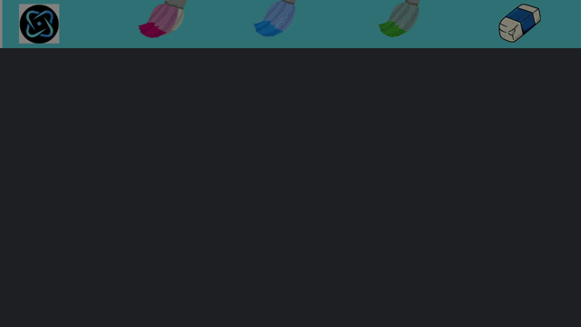
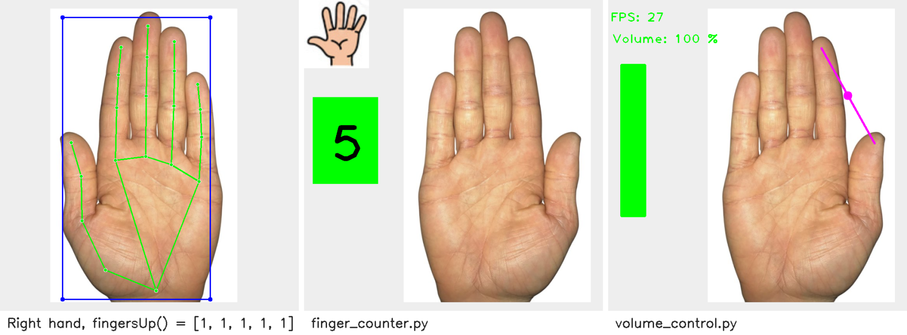
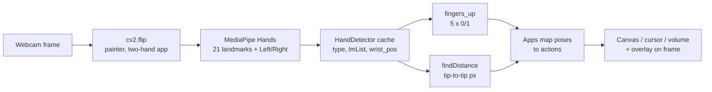

# Hand Gesture Control

Control your computer with bare hands. A webcam, MediaPipe hand tracking and a few finger poses replace the mouse, the volume keys and the paintbrush: five small OpenCV apps built on one shared hand-tracking module, plus a minimal MediaPipe starter script.

[](https://github.com/ParshvCrafts/Hand-Gesture-Control/actions/workflows/tests.yml)

[](LICENSE)

<p align="center">
  
  <br>
  <sub><code>virtual_painter.py</code>'s own render loop, with a scripted fingertip path standing in for the camera (no hand in frame).</sub>
</p>

<p align="center">
  
  <br>
  <sub>Real MediaPipe output on a real photo: the shared module (mirrored frame), then the finger counter's and volume control's unmodified loops. Photo: <a href="https://commons.wikimedia.org/wiki/File:Right_Hand_Palm.png">Eyefive45</a>, CC BY-SA 4.0.</sub>
</p>

## The apps

| App | Gesture | Result |
| --- | --- | --- |
| [`virtual_painter.py`](virtual_painter.py) | Right hand, index + middle up: pick a colour or the eraser in the toolbar. After picking, index only: draw. Left hand, index + middle in the toolbar: clear | Air-drawing canvas blended over the live video |
| [`virtual_mouse.py`](virtual_mouse.py) | Any one hand. Index only: move the cursor (smoothed). Index + middle pinched (< 40 px apart): click | System mouse control |
| [`volume_control.py`](volume_control.py) | Thumb-to-index distance, 30 to 250 px | System volume, with an on-screen volume bar |
| [`mouse_and_volume_control.py`](mouse_and_volume_control.py) | Right hand drives the mouse. Left hand changes volume (pinch 30 to 200 px) only in a "pinch lock" pose: thumb + index up, other three down. Open any other finger to lock the level | Both at once, two hands |
| [`finger_counter.py`](finger_counter.py) | Hold up 0 to 10 fingers on one or two hands | Live count with a matching overlay image |
| [`hand_tracking_basics.py`](hand_tracking_basics.py) | None | Minimal MediaPipe Hands example: landmarks + FPS |

## Quick start

```bash
python -m venv venv
venv\Scripts\activate          # macOS/Linux: source venv/bin/activate
pip install -r requirements.txt
python virtual_painter.py      # press q to quit
```

Needs a webcam and Python 3.11. The mouse and volume apps import `autopy` and `pycaw`, so they are **Windows only** and fail at import elsewhere. `requirements.txt` skips those packages on other systems, where the painter, finger counter and basics run as-is.

## How it works



1. OpenCV grabs a frame. The painter and the two-hand app mirror it, so moving your hand right moves things right.
2. [`HandDetector.findHands()`](hand_tracking_module.py) runs MediaPipe Hands once and caches each hand as a dict with `type`, `lmList`, `handNo`, `mp_label` and `wrist_pos`, where `lmList` maps landmark id to pixel `(x, y)`.
3. [`fingers_up()`](hand_tracking_module.py) turns landmarks into `[thumb, index, middle, ring, pinky]`. A finger is up when its tip is above its middle joint. The thumb moves sideways, so it compares x positions instead, and the direction depends on the hand's label. This assumes the palm faces the camera; the back of the hand inverts the thumb.
4. Each app maps those flags and landmark distances to an action. The mouse maps a reduced frame region to the full screen (so you can reach the edges without leaving the camera's view) and moves 1/7 of the way to the target each frame to damp jitter. Volume maps pinch distance linearly onto the system's dB range.

### Engineering notes

- **Labels with a hidden carriage return.** On Windows, the `mediapipe==0.10.8` wheel ships its `handedness.txt` with CRLF line endings, so hands come back labelled `"Right\r"` and `"Left\r"`. Every `hand["type"] == "Right"` check failed silently: the painter and the two-hand app could not react to a hand at all. The module now strips the label where it enters the program, and a test feeds it `"Right\r"` to keep it that way.
- **Thumb rule checked against real photos.** MediaPipe assumes a mirrored (selfie) frame, so a hand it calls "Right" has its thumb on the image's left side whatever the actual orientation of the camera. A flip mirrors the geometry and swaps the label together, so one rule (`"Right"`: extended when tip x < joint x) works on flipped and unflipped frames alike. The shared module had this reversed. The fix agrees with the two apps' original hand-written copies and with MediaPipe's output on two real palm photos, each tested plain and mirrored (one is committed as the test fixture).
- **Mapping over the real frame size.** Cameras often ignore the requested capture size. The mouse apps used to map gestures over hard-coded frame sizes (1200×1080 and 2000×1200). On a 1280×720 webcam that left the bottom quarter of the screen unreachable in `virtual_mouse.py` and the right third in the two-hand app. They now read one frame and use its actual size.

## Tests

```bash
pip install pytest
pytest -q tests
```

GitHub Actions runs this on Ubuntu and Windows for every push.

- [`tests/test_hand_tracking_module.py`](tests/test_hand_tracking_module.py): the thumb rule for both labels and under mirroring, label stripping, and one end-to-end run of real MediaPipe on a real photo ([`tests/fixtures/`](tests/fixtures/ATTRIBUTION.md)) in both orientations.
- [`tests/test_virtual_painter.py`](tests/test_virtual_painter.py): drives the painter's real loop with scripted hands through select, draw, a frame with no hand, and a two-hand frame where the second hand clears the canvas without changing the selected tool.

The label, real-photo and painter tests were run against the pre-fix code and fail there.

## Project structure

```
hand_tracking_module.py      shared detector + fingers_up(), used by the five apps
virtual_painter.py           air canvas
virtual_mouse.py             cursor + click
volume_control.py            pinch-to-volume
mouse_and_volume_control.py  two hands: mouse + volume
finger_counter.py            0-10 finger count
hand_tracking_basics.py      standalone minimal MediaPipe example
assets/                      toolbar and finger-count overlay images
tests/                       pytest suite + real-photo fixture
tools/capture_readme_assets.py  regenerates docs/assets/ (GIF, strip, social preview); needs ffmpeg
```

## Status

- **Verified:** the test suite (10 tests) passes locally on Windows. All seven scripts (six apps + the module's demo) run end to end in a headless smoke harness (fake camera fed the fixture photo, stubbed display, mouse and audio; the harness lives in the parent workspace, not this repo). Hand labels and finger states are correct on real photos of open palms.
- **Not yet verified on a live webcam:** the end-to-end feel of each gesture, and thumb detection with the thumb folded (the photos only show extended thumbs).

## License

[MIT](LICENSE). The test photo in `tests/fixtures/` is CC BY-SA 4.0; see its [attribution](tests/fixtures/ATTRIBUTION.md).
